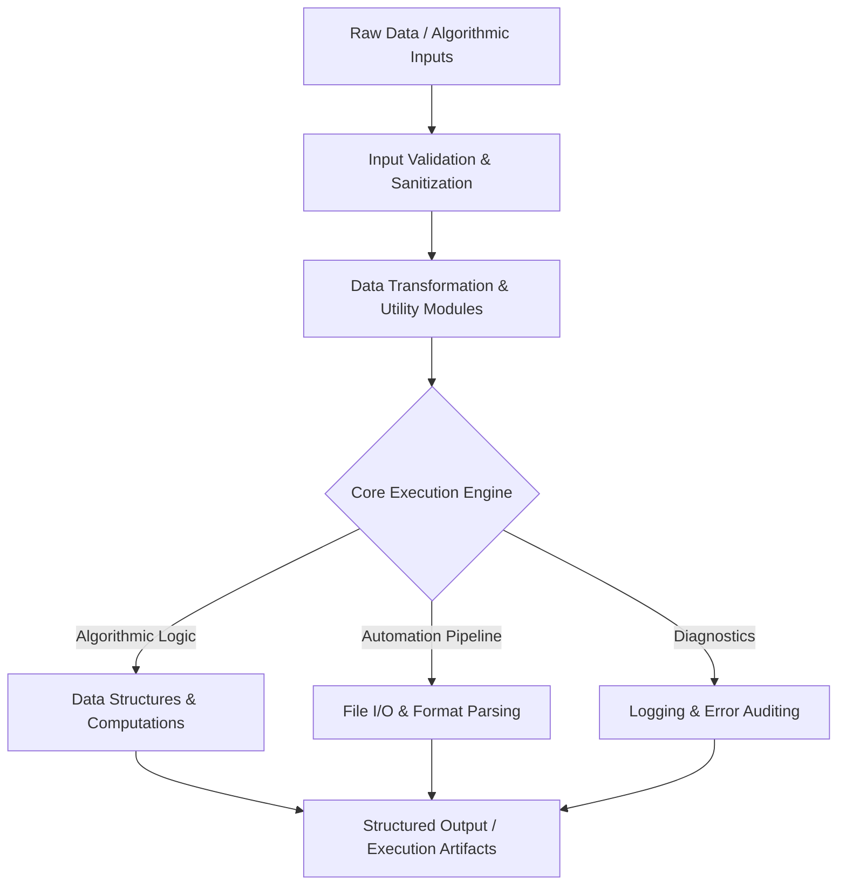

<div align="center">


[](https://www.python.org/)
[](#)
[](#)
[](#)

</div>

---

## 📌 Executive Summary / Overview

The **Python Engineering & Systems Lab** (`PythonProject`) provides an integrated development workspace designed for applied Python engineering, data processing automation, algorithmic problem solving, and script optimization.

As part of continuous software development practice, this repository hosts modular utilities, file automation scripts, and foundational algorithmic exercises designed to maintain peak efficiency in Python standard library usage, virtual environment management, and cross-platform automation.

---

## 📖 Interactive Table of Contents

- [Executive Summary / Overview](#-executive-summary--overview)
- [Key Features & Capabilities](#-key-features--capabilities)
- [System Architecture & Engineering Lifecycle](#-system-architecture--engineering-lifecycle)
- [Tech Stack Breakdown](#-tech-stack-breakdown)
- [Engineering Disciplines & Modules](#-engineering-disciplines--modules)
- [Reproducible Quickstart & Setup](#-reproducible-quickstart--setup)
- [Project Directory Layout](#-project-directory-layout)
- [Author & Contributions](#-author--contributions)

---

## ✨ Key Features & Capabilities

- **Automated Computational Scripting**: Streamlined command-line scripts for data extraction, string parsing, and format transformations.
- **Algorithmic Optimization**: Explores memory and execution efficiency across core Python built-ins (`collections`, `itertools`, `functools`).
- **Clean Code & Idiomatic Python**: Adheres to PEP 8 standards with descriptive variable naming, type hinting, and docstrings.
- **Robust Exception Handling**: Implements defensive try-except blocks ensuring graceful failure modes during file and network I/O.
- **Cross-Platform Compatibility**: Fully compatible with Linux, macOS, and Windows environments without platform-specific dependencies.

---

## 🏗️ System Architecture & Engineering Lifecycle



---

## 🛠️ Tech Stack Breakdown

| Category | Technologies & Tools |
| :--- | :--- |
| **Language** | Python 3.9+ |
| **Standard Libraries** | `os`, `sys`, `math`, `collections`, `itertools`, `json` |
| **Development Tools** | VS Code, PyCharm, Git CLI, Virtualenv |
| **Standards** | PEP 8, Type Annotations, Defensive Programming |

---

## 🔬 Engineering Disciplines & Modules

| Module Focus | Core Capabilities | Practical Application |
| :--- | :--- | :--- |
| **Data Structures** | Custom lists, queues, dictionary lookups | In-memory record indexing and caching |
| **Algorithms** | Sorting, two-pointer searches, matrix math | Algorithmic puzzle resolution and optimization |
| **File Systems** | Directory traversals, path normalizations | Automated batch file renaming and organization |
| **CLI Tools** | Argument parsing, formatted console tables | Terminal utility construction for developer tooling |

---

## 🚀 Reproducible Quickstart & Setup

### Prerequisites
- Python 3.9+ installed and verified (`python --version`)

### Step 1: Clone the Repository
```bash
git clone https://github.com/Jeshwanthika07/PythonProject.git
cd PythonProject
```

### Step 2: Set Up Environment
```bash
# Create and activate virtual environment
python -m venv venv
# On Windows:
.\venv\Scripts\activate
# On Linux/macOS:
source venv/bin/activate
```

---

## 📂 Project Directory Layout

```text
PythonProject/
│
├── README.md                  # Comprehensive engineering documentation
└── LICENSE                    # Open-source MIT license
```

---

## 👩‍💻 Author & Contributions

Authored by **[Jeshwanthika Pothamchetty](https://github.com/Jeshwanthika07)**  
*Alliance University | Department of Computer Applications*

<div align="center">


</div>
